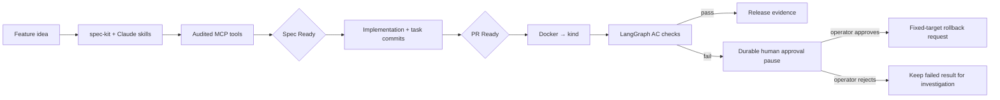

# SpecGate

**An idea becomes a specification. A release needs evidence. A rollback needs a human.**

[](https://github.com/RJMTaef/specgate/actions/workflows/ci.yml)

SpecGate is a Python reference implementation of a spec-driven agentic delivery
pipeline. Claude Code skills extend **GitHub spec-kit** through specify → clarify →
plan → tasks → implement. A custom **MCP server**, **GitHub Actions gates**, and a
durable **LangGraph operational agent** carry the evidence through deployment and
post-implementation verification (PIV).

The sample application is a transaction screening API, chosen to demonstrate
explainable rules and controlled recovery in a regulated-industry setting. It uses
synthetic data and demonstration policies; it is not a production AML system.

## Machine-checked controls rather than advisory guidance

| Required check | What makes it fail |
| --- | --- |
| **Spec Ready** | Missing/empty spec, plan, or task list; no acceptance criteria; duplicate IDs; unresolved clarifications; missing AC-to-smoke mapping; detected secrets |
| **PR Ready** | Failing tests/lint; coverage below 85%; coverage lower than PR base; incomplete tasks; missing, unreachable, empty, or incorrectly labeled task commits; detected secrets |
| **Deploy + PIV** | Docker/kind deployment fails; rollout fails; any deployed acceptance smoke test fails |

The protection setup script requires all three checks on `main`, requires the PR
to be up to date, includes administrators, and blocks force pushes and deletion.
Workflows alone do **not** activate branch protection; an administrator runs
`bash scripts/protect-main.sh OWNER/REPO`. Inspect the live rules in
[repository settings](https://github.com/RJMTaef/specgate/settings/branches).



## Run in two minutes

Prerequisites: Python 3.12+, [uv](https://docs.astral.sh/uv/), Git.
No model API key is needed for the API, gates, tests, MCP server, or PIV.

```bash
git clone https://github.com/RJMTaef/specgate.git
cd specgate
uv sync --frozen --extra dev
uv run pytest --cov --cov-report=json:coverage.json
uv run specgate gate spec
uv run specgate gate pr --coverage coverage.json
uv run uvicorn specgate.screening:app --host 127.0.0.1 --port 8000
```

In another terminal:

```bash
curl -s http://127.0.0.1:8000/screen \
  -H 'Content-Type: application/json' \
  -d '{"transaction_id":"demo-1","amount":"12500.00","currency":"USD","destination_country":"CA","beneficiary":"Demo Person"}'
uv run specgate piv
```

The API returns `flagged: true`, `reasons: ["LARGE_TRANSFER"]`, and
`rules_version: "demo-v1"`. Explore [OpenAPI docs](http://127.0.0.1:8000/docs).
Use Decimal amounts with up to two decimal places. USD is the only currency.
Synthetic destination codes `XZ`/`ZZ` and beneficiary `Blocked Demo Entity` exercise
the other rules. Multiple matches return all applicable reasons.

## Author a feature with Claude Code

Start Claude Code in the repository and approve the repository-local MCP server
when Claude asks. `.mcp.json` launches `uv run --frozen specgate-mcp` over stdio.
The upstream `speckit-*` skills are installed alongside our `specgate-*` wrappers.

```text
/specgate-specify Add a screening rule with stable reason codes
/specgate-clarify
/specgate-plan
/specgate-tasks
/specgate-implement
```

Each wrapper executes the corresponding upstream spec-kit skill, maintains
`specs/NNN-feature/{spec.md,plan.md,tasks.md}`, and adds our machine-readable
`acceptance.yaml` contract. `AC-NNN` identifiers must match exactly between
Markdown acceptance criteria and smoke checks. There is no placeholder approval
that can substitute for a passing CI result.

Completed task format:

```text
- [x] T001 Implement the rule. <!-- commit: FULL_40_CHARACTER_COMMIT_SHA -->
```

The linked commit must be an ancestor of HEAD, contain file changes, and name
`T001` in its message. Commit the implementation first, then record its SHA in a
follow-up evidence commit. This verifies traceability, not semantic correctness
of the implementation; tests and human review still matter.

Use **merge commits** for PRs. Squash/rebase merges replace implementation SHAs and
would break task evidence. The protection setup script disables those merge modes
and binds required checks to the GitHub Actions application.

The MCP server exposes `validate_spec`, `check_gate`, `get_pipeline_status`,
`run_piv`, and `guard_output`. PR evidence is produced by CI, so the MCP `check_gate`
call cannot manufacture a passing PR check without test coverage evidence.

## Deploy locally and verify the release

Install Docker, kind, and kubectl, then start Docker:

```bash
bash scripts/deploy-local.sh
kubectl --context kind-specgate -n specgate port-forward svc/screening 8000:8000
# In another terminal:
uv run specgate piv
```

The deployment uses a commit-tagged local image, a non-root container, a read-only
filesystem, readiness/liveness probes, and resource limits. CI runs the same
deployment and PIV against an ephemeral cluster on every eligible PR and main push.
This is a local-cluster delivery demonstration, not a hosted production service.

Every AC is exercised against the forwarded deployed API. PIV uses a deterministic
LangGraph state graph, so it is repeatable and requires no LLM to decide whether a
test passed. SQLite checkpoints survive CLI/MCP process restarts.

To demonstrate the approval pause, stop the forwarded API and run PIV again. It
returns a run ID, failed AC IDs, and `awaiting_approval` with a nonzero exit code.

```bash
uv run specgate piv-resume RUN_ID                 # explicitly reject recovery
uv run specgate piv-resume ANOTHER_RUN_ID --approve # prompts for human confirmation
```

Only the local operator CLI exposes resume; there is **no MCP approval tool**.
Approval can request only `kubectl --context kind-specgate -n specgate rollout undo
deployment/screening`. No model-supplied command is executed. A successful command
means `rollback_requested`, not that recovery has been verified. Check rollout and
run PIV again. A rollback needs a previous successful deployment revision; a first
deployment cannot necessarily be restored. In CI, investigate the uploaded
checkpoints; the disposable cluster is not retained for later recovery.

## Audit, guardrails, and trust boundary

- Every MCP operation records start/outcome metadata. PIV records each AC result,
  approval, and recovery request. Claude hooks record tool actions without raw
  arguments, responses, beneficiary names, or transaction bodies.
- `guard_output` scans text before writing it to `agent-output/`. Claude pre/post
  hooks check tool data and report detected secrets without echoing them. CI scans
  repository text before PR Ready passes. Matches report rule names, never values.
- SQLite audit records are SHA-256 chained and verified by `specgate audit`.
  This detects retained-chain edits; it is **not** immutable, externally anchored
  storage. Deletion/rewrite by a privileged local user is outside this boundary.
- Secret patterns cover common GitHub/AWS credentials, private keys, and long
  credential assignments. They are defense in depth, not a guarantee of DLP.
  CI cannot prevent someone from putting a secret in the initial Git push.
- PIV permits HTTP loopback origins only, disables redirects and proxy inheritance,
  and limits check paths to the two sample endpoints.
- The local operator owns the CLI, filesystem, and Kubernetes credentials. A
  production setup needs separate operator identity/RBAC, protected gate policy,
  signed artifacts, centralized audit retention, and production secret scanning.
  Administrators can change repository rules. Pull requests can change gate code;
  require trusted review of workflow/policy changes before using this pattern for
  adversarial or regulated workloads.

## Adoption signals

Run `uv run specgate metrics`. CI publishes **gate pass rate** and **spec-to-PR
time** in the job summary and `gate-evidence` artifact, next to coverage and audit
records. Pass rate is scoped to the current local audit database/CI job; it is not
an organization-wide adoption claim. Lead time measures the first spec commit to
GitHub's PR creation timestamp and is unavailable until a PR exists. Download and
aggregate artifacts for a longer observation window. No synthetic adoption
numbers are presented as real usage.

## Layout and development

| Path | Responsibility |
| --- | --- |
| `.specify/`, `.claude/skills/speckit-*` | Actual GitHub spec-kit templates, scripts, workflow, and Claude integration |
| `.claude/skills/specgate-*` | Custom delivery skills calling MCP controls |
| `src/specgate/` | API, gates, MCP server, operational graph, audit, and metrics |
| `specs/001-transaction-screening/` | Worked feature with AC-mapped smoke inputs |
| `deploy/`, `scripts/` | kind deployment, Claude hooks, branch protection setup |
| `.github/workflows/ci.yml` | Required delivery checks and evidence artifacts |

```bash
uv run ruff check src tests
uv run pytest --cov --cov-report=term-missing --cov-report=json:coverage.json
uv run specgate scan
uv run specgate audit
```

See [architecture decisions](docs/architecture.md), [demo walkthrough](docs/demo.md),
and [upstream provenance](THIRD_PARTY_NOTICES.md). MIT licensed.
